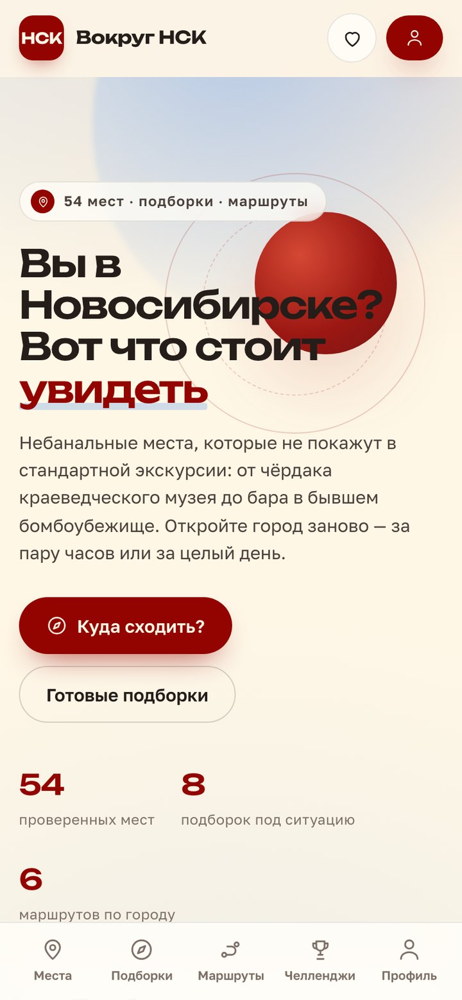
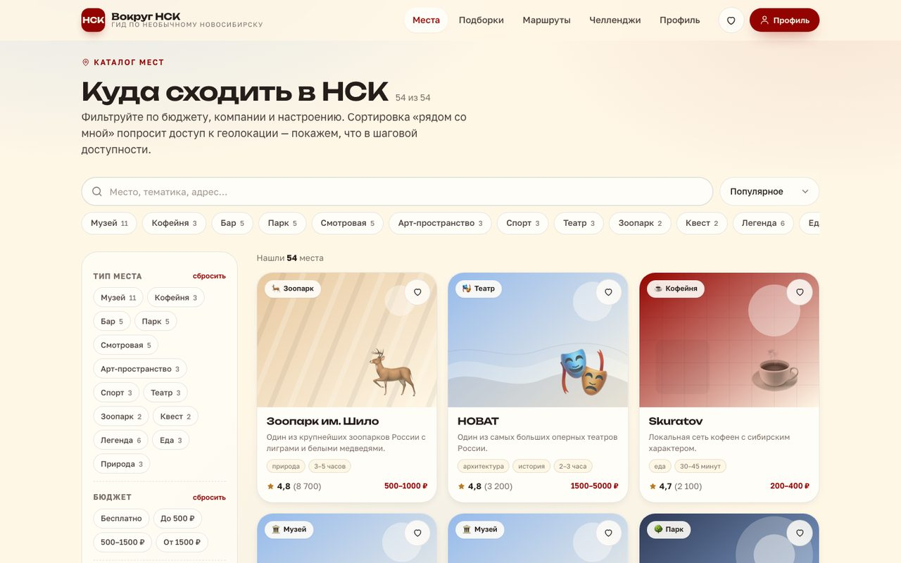
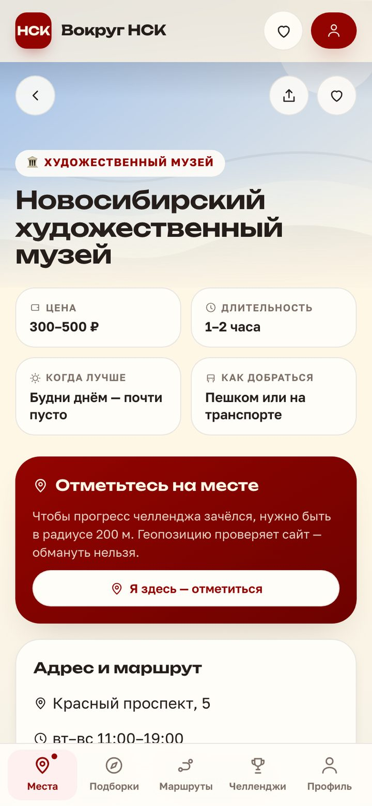
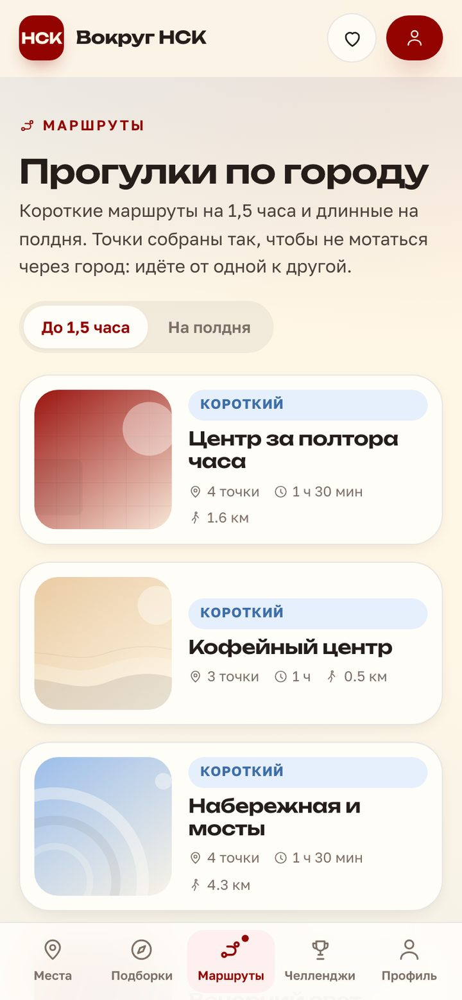

# Вокруг НСК

Мобильный гид по необычному Новосибирску для туристов, которые остановились в отелях города.
Открывается по QR-коду в номере или на ресепшене — без установки приложения и обязательной
регистрации. Показывает места, собирает подборки и маршруты, а за посещения начисляет прогресс в
челленджах с призами от партнёров.

> Статус: рабочий прототип (MVP). Фронтенд, API, гео-проверка чек-инов, отзывы и офлайн-кэш уже
> работают. Данные о местах — демонстрационные, см. раздел «Данные и ограничения».

---

## Как это выглядит

| Главная, телефон | Каталог, десктоп |
| --- | --- |
|  |  |

| Карточка места | Маршруты |
| --- | --- |
|  |  |

---

## Что уже есть

**Главная**
- Приветственный экран с параллаксом (силуэт города, мост, «солнце») и быстрыми фильтрами:
  бюджет, компания, длительность, настроение.
- Рандомайзер: 3 карточки с анимацией переворота, «Удиви меня» и переход в карточку места.
- Карта города с метками (Leaflet + OpenStreetMap).
- Блок «Мы в соцсетях» и подписка, блок «как это работает», популярное и небанальное.

**Каталог мест (`/mesta`)**
- 54 места с карточками: категория, тематика, цена, длительность, рейтинг.
- Фильтры: тип места, бюджет, компания, длительность, настроение, тематика, время суток, способ
  передвижения; поиск по названию/описанию/адресу.
- Сортировки: «популярное», «рядом со мной» (геолокация), «небанальное», «по рейтингу».
- Состояние фильтров синхронизировано с URL — ссылкой можно поделиться.
- Мобильные фильтры открываются нижним листом (bottom sheet), на десктопе — сайдбар.

**Карточка места (`/mesta/:id`)**
- Параллакс-обложка, факты (цена, длительность, лучшее время, как добраться), советы местных.
- Отзывы: сводка, распределение оценок, форма добавления (сохраняется локально и уходит в API,
  если бэкенд доступен).
- Чек-ин «Я здесь» с проверкой геолокации: радиус 200 м, показывается расстояние до точки.
- Мини-карта, маршрут и ссылки в Яндекс Карты, похожие места.

**Подборки (`/podborki`)**
- 8 сценариев: за 2 часа, свидание, с детьми, бюджетно, небанальное, зимнее, летние веранды,
  «тёмный» НСК. Внутри — список мест и маршрут по подборке в Яндекс Картах.

**Маршруты (`/marshruty`)**
- Короткие (до 1,5 ч) и длинные (на полдня), суммарное расстояние считается по координатам.
- Таймлайн остановок с расстоянием и пешим временем между точками, карта с линией маршрута.

**Челленджи (`/chellendzhi`)**
- Прогресс по чек-инам, награды и промокоды при завершении, проверка присутствия по геопозиции.
- Демо-режим геолокации (в профиле) — чтобы показывать механику на ноутбуке.

**Профиль (`/profil`)**
- Имя, статистика, 10 достижений, прогресс по челленджам, избранное, настройки.
- Всё хранится в `localStorage` — без регистрации. Есть очистка данных.

**PWA / офлайн**
- `manifest.webmanifest` (режим `browser` — приложение не ставится отдельно, как и требовалось),
  service worker кэширует оболочку и статику: после первого открытия сайт открывается офлайн.
- Плитки карты и внешние шрифты в офлайне недоступны — это осознанное ограничение.

---

## Стек

| Слой | Технологии |
| --- | --- |
| Фронтенд | React 19, TypeScript, Vite 8, React Router 7, Leaflet 1.9 |
| Стили | Собственная дизайн-система на CSS-переменных (без UI-китов) |
| Бэкенд | ASP.NET Core Minimal API, .NET 10 |
| Данные | Единый JSON-сид (`frontend/src/data/seed.json`) + in-memory репозиторий |
| PWA | Service worker + Web App Manifest (свой, без Workbox) |

Палитра: `WINE #930400`, `MILK #fff7e6`, `HEAVENLY #95baeb`, графитовый `#241d1a`.
Шрифты: Unbounded (заголовки), Golos Text (текст), системный fallback для офлайна.

---

## Структура

```
vokrug-nsk/
├── frontend/                  # React + Vite
│   ├── public/                # manifest, sw.js, иконки, favicon
│   └── src/
│       ├── components/        # Layout, карточки, карта, рандомайзер, фильтры
│       ├── pages/             # Home, Places, PlaceDetail, Collections, Routes, Challenges, Profile
│       ├── lib/               # store (localStorage), geo, фильтры, API-клиент, игровая логика
│       ├── data/seed.json     # ЕДИНЫЙ источник демо-данных (его же читает бэкенд)
│       └── styles/            # дизайн-токены и стили
├── backend/Nsk.Api/           # ASP.NET Core Minimal API
│   ├── Program.cs             # эндпоинты /api/*
│   ├── Models.cs              # контракты
│   └── Data/SeedRepository.cs # загрузка сида, чек-ины, haversine
└── README.md
```

---

## Быстрый старт

Нужны Node.js 20+ и .NET SDK 10. Проверьте: `node -v`, `dotnet --version`.

### 1. Фронтенд

```bash
cd frontend
npm install
npm run dev            # http://localhost:5173
```

Dev-сервер проксирует `/api` на `http://localhost:5080` (см. `vite.config.ts`, можно переопределить
переменной `VITE_API_PROXY`).

### 2. Бэкенд

```bash
cd backend/Nsk.Api
dotnet run             # http://localhost:5080
```

Если .NET не установлен (на этом Mac его не было):

```bash
# без sudo, в домашнюю папку
curl -sSL https://dot.net/v1/dotnet-install.sh | bash -s -- --channel 10.0
export PATH="$HOME/.dotnet:$PATH"
```

Или `brew install --cask dotnet-sdk`.

Фронтенд продолжит работать и без бэкенда: он использует локальный сид, а статус API виден в подвале
и в профиле (`online`/`offline`).

### 3. Продакшен-сборка

```bash
cd frontend
npm run build          # dist/
```

Варианты хостинга:
- статикой (GitHub Pages, Netlify, Vercel, nginx) + отдельно API. Укажите адрес API при сборке:
  `VITE_API_URL=https://api.example.com npm run build`;
- всё с одного origin: скопируйте `frontend/dist/*` в `backend/Nsk.Api/wwwroot/`, бэкенд отдаст SPA
  и API с одного порта (`UseDefaultFiles` + `MapFallbackToFile("index.html")`).

Для GitHub Pages с относительным путём добавьте в `vite.config.ts` `base: '/NSKproject/'`.

---

## API

Базовый путь — `/api`. Ответы в camelCase, ошибки — `{ "message": "..." }`.

| Метод | Путь | Назначение |
| --- | --- | --- |
| GET | `/health` | Статус и количество сущностей |
| GET | `/places` | Список с фильтрами (`budget`, `company`, `duration`, `category`, `theme`, `timeOfDay`, `transport`, `mood`, `q`, `sort`) |
| GET | `/places/{id}` | Место |
| GET | `/places/{id}/reviews` | Отзывы (сид + добавленные) |
| POST | `/places/{id}/reviews` | Новый отзыв `{ author, rating, text }` |
| GET | `/collections`, `/collections/{id}` | Подборки |
| GET | `/routes`, `/routes/{id}` | Маршруты |
| GET | `/challenges` | Челленджи |
| POST | `/checkins` | Чек-ин `{ placeId, lat, lng, deviceId }` → `{ ok, distance, radius, message }` |
| GET | `/checkins/{deviceId}` | История чек-инов устройства |

Пример проверки геозоны:

```bash
curl -s -X POST http://localhost:5080/api/checkins \
  -H 'Content-Type: application/json' \
  -d '{"placeId":"art-museum","lat":55.0287,"lng":82.9210,"deviceId":"demo"}'
```

Ответ: `{"ok":true,"distance":0,"radius":200,...}`. Если точка дальше 200 м —
`ok:false` и расстояние («Вы в N м от места»). Клиент делает ту же проверку локально, чтобы
показывать расстояние мгновенно, но сервер всегда перепроверяет — иначе приз можно было бы
получить подменой координат в браузере.

---

## Данные и ограничения

**Где лежат.** `frontend/src/data/seed.json` — 54 места, 8 подборок, 6 маршрутов, 5 челленджей.
Файл импортируется фронтендом (офлайн-фолбэк) и копируется в сборку бэкенда как `Data/seed.json`.
Чтобы поменять контент, правьте JSON — обе части подхватят изменения без кода.

**Достоверность.**
- Адреса и названия — реальные новосибирские места из брифа проекта.
- Координаты подставлены по улицам и районам (точность ~100–300 м). Для продакшена их нужно
  выверить через геокодер (Яндекс/2ГИС API) — иначе чек-ин может не сработать у входа.
- Отзывы — демонстрационные, сгенерированные для прототипа и помеченные «Яндекс Карты». Это не
  выгрузка реальных отзывов.
- Часы работы и цены — ориентировочные, перед публикацией нужно сверить.

**Про отзывы из Яндекс Карт / 2ГИС.** Автоматически скрапить их нельзя — это нарушает условия
использования сервисов. Легальные варианты: официальный API (нужен ключ и тариф), партнёрская
выгрузка или собственные отзывы пользователей. В коде уже есть готовая структура и эндпоинт —
достаточно заменить источник сида.

**Призы.** Промокоды детерминированно генерируются из id челленджа — это часть прототипа, а не
обязательства партнёров. Реальная выдача требует бэкенда с базой и интеграции с партнёром.

**Приватность.** Регистрации нет. Избранное, чек-ины и отзывы хранятся в `localStorage`; на сервер
уходят только координаты при чек-ине (для проверки) и текст отзыва. В продакшене стоит добавить
срок хранения координат и политику конфиденциальности.

---

## Что дальше (roadmap)

1. **База данных** вместо in-memory: PostgreSQL + EF Core, миграции, сид из JSON.
2. **Авторизация** (номер телефона / анонимный токен устройства), перенос прогресса между
   устройствами, антифрод для чек-инов (несколько устройств, скорость перемещения).
3. **Реальные данные**: геокодер адресов, синхронизация отзывов через официальный API, фото мест.
4. **Партнёрский кабинет**: выдача призов, статистика посещений, QR-коды отелей с метками.
5. **Улучшения карты**: кластеризация, офлайн-плитки, свои стили карты под палитру.
6. **Доступность и SEO**: пререндер карточек, разметка Schema.org, аудит WCAG 2.1 AA.
7. **Тесты**: Vitest для фильтров/гео, Playwright для основных сценариев, xUnit для API.

---

## Скрипты

```bash
# frontend
npm run dev         # dev-сервер
npm run build       # типы + продакшен-сборка
npm run preview     # предпросмотр сборки
npm run lint        # oxlint
npm run typecheck   # только типы

# e2e и скриншоты (нужен запущенный dev-сервер)
npm run e2e           # 14 сценариев: фильтры, избранное, гео-чек-ин, отзывы
npm run screenshots   # обновить скриншоты в frontend/screenshots

# backend
dotnet build
dotnet run
```

E2E-проверка проходит 14 из 14 сценариев (включая чек-ин с реальной геолокацией через
Playwright и отказ при расстоянии больше 200 м).

Проект использует демонстрационные данные. Если используете его как основу для коммерческого
продукта — замените сид, проверьте юридические тексты и условия партнёрских программ.
